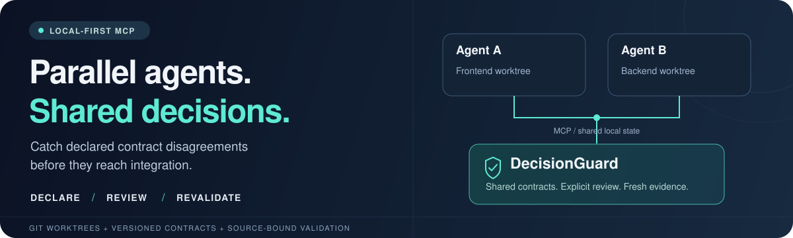
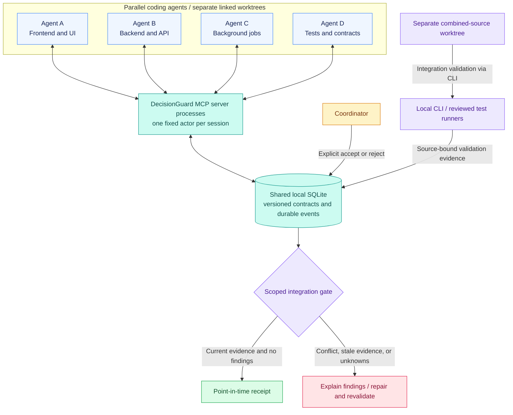

<div align="center">

# DecisionGuard

### Keep parallel coding agents aligned before you integrate their code.




[Why use it?](#why-decisionguard) &nbsp; / &nbsp; [How it works](#how-it-works) &nbsp; / &nbsp; [Try the demo](#quickstart) &nbsp; / &nbsp; [Connect your agents](#connect-your-agents) &nbsp; / &nbsp; [Limits](#what-the-gate-does-and-does-not-prove)

</div>

**DecisionGuard is a local Model Context Protocol (MCP) server and CLI for developers running
2-4 coding agents in separate Git worktrees.** It gives those agents shared, versioned
contracts, makes proposed changes visible to dependent tasks, and checks fresh validation
evidence before integration.

The core needs **no LLM, API key, cloud account, or hosted service**.

> [!NOTE]
> **Local alpha (`0.1.0`).** The CLI and MCP stdio server are implemented and locally tested.
> Use them as a supervised, same-user developer tool. Broader real-user benefit and production
> reliability remain unverified. See the [release checklist](docs/RELEASE_READINESS.md).

## Why DecisionGuard?

**A clean Git merge can still combine incompatible assumptions.**

Imagine one agent changing a checkout API while another builds its client. They edit different
files. One changes the public amount from decimal rupees to integer paise; the other still
sends rupees. Git can merge both branches without a conflict, yet the combined behavior is
wrong by **100x**.

DecisionGuard's [checkout demo](examples/checkout/README.md) reproduces this failure with real
local worktrees and checks. It records the public amount unit as a contract, surfaces the
proposed change to dependent tasks, and blocks the scoped gate until the disagreement is
resolved and current code is validated.

| When parallel work goes wrong | What DecisionGuard adds |
|---|---|
| Agents implement different meanings for the same field. | Explicit contracts and implementation assumptions that can be compared. |
| A shared decision changes while another task keeps working. | Pending-impact findings and durable events that dependent agents can poll. |
| An agent says it has read or acknowledged the change. | Separate states for acknowledgement, refreshed dependencies, and validated implementation. |
| Tests passed before a contract or source change. | Evidence bound to source, configuration, and decision versions; accepted changes invalidate affected evidence atomically. |
| Each branch looks ready on its own. | A combined-source check in a distinct integration worktree before a multi-task gate can pass. |

### When it earns a place in your workflow

Use it when several coding agents work on **shared API boundaries, units, authentication
expectations, error formats, or retry behavior**, and you want an explicit review and
revalidation trail. Linked worktrees on one machine share the same local state.

Keep your schemas, code generation, contract tests, and integration tests. Those tools check
the behavior you encode; DecisionGuard tracks **which accepted decisions each task depends
on and whether its evidence is still current**. If your existing checks already catch a
mismatch, they deserve that credit. The [strong-baseline fixture](examples/strong-baseline/README.md)
illustrates this boundary.

## How it works

An agent uses MCP to read context, declare expectations, propose changes, and inspect findings.
A configured coordinator explicitly reviews proposals. The trusted local CLI runs the test
commands you reviewed. Both interfaces use the same application services and shared database.

The example below shows **four agents working together**, each with its own task, linked
worktree, and fixed-actor MCP session. All four share the same reviewed contracts and change history.



1. **Declare the shared boundary.** Register tasks, worktrees, approved file scope, and
   contract dependencies. Each agent declares what its implementation expects at an accepted
   version, such as `checkout.public.request / amount.unit = INR.major.decimal-string`.
2. **Propose before changing the agreement.** A proposal leaves the accepted version intact
   and exposes pending impact. A configured coordinator accepts or rejects it explicitly.
   Published versions are immutable; acceptance emits events and invalidates affected evidence.
3. **Revisit dependent code.** Agents poll before editing a shared boundary, after substantial
   work, and before completion. They inspect the impact, repair code, refresh dependencies,
   and update changed assumptions. **Acknowledgement alone cannot clear the gate.**
4. **Validate the implementation.** The local CLI executes your configured runner against
   current source. A newer failed or interrupted validation blocks an older success.
5. **Check the actual combination.** Prepare a distinct linked integration worktree containing
   the combined source. Validate its integration task, then gate it alongside the individual
   tasks. DecisionGuard reports findings or records a scoped, point-in-time receipt.

**You control review, test commands, and integration.** DecisionGuard does not merge branches,
run commands supplied over MCP, or automatically discover every undeclared disagreement.
A receipt does not make a later Git merge atomic.

## Quickstart

You need Git, [Python 3.11+](https://www.python.org/downloads/), and
[uv](https://docs.astral.sh/uv/). From a clone of this repository:

```powershell
uv sync --locked --group dev
uv run decisionguard runtime
uv run decisionguard demo
```

**Runtime preflight must pass before the demo or project initialization.** DecisionGuard
requires SQLite with the upstream WAL-reset fix; Python's version alone is insufficient.
If preflight fails, follow the [isolated runtime setup](docs/RUNTIME_SETUP.md), then rerun
`runtime` and `demo` using that verified environment. The lockfile cannot update Python's
bundled SQLite library.

The demo creates new disposable linked worktrees under `artifacts/` and walks through:

| Stage | What you can observe |
|---|---|
| Propose a unit change | Dependent tasks show pending impact. |
| Accept and combine incompatible edits | Git merges cleanly; the real combined check fails with `499 != 49900`. |
| Acknowledge the event | The gate remains blocked. |
| Repair, refresh, and revalidate | Fresh task and combined-source checks pass. |

Agent and coordinator actions are deterministic simulations; worktrees, validation commands,
and the reproduced failure are real local operations. No model is called. See the
[demo walkthrough](examples/checkout/README.md) for details and the rejection/conversion path.

<details>
<summary><strong>Explore the planted compatibility benchmark</strong></summary>

```powershell
uv run decisionguard benchmark
```

This measures labeled fixture classifications and lifecycle behavior. It is not a live-agent
effectiveness or production reliability score. If Windows blocks the default uv cache, set
`UV_CACHE_DIR` to a writable directory outside captured source.

</details>

## Connect your agents

### 1. Initialize your repository with a reviewed runner

Create a runner JSON file **outside your project's captured source**. Point it at the Python
environment and tests for *your* repository (this Windows path is an example):

```json
{
  "argv": ["D:/YourRepository/.venv/Scripts/python.exe", "-m", "pytest", "-q"],
  "cwd": ".",
  "timeout": 120,
  "output_limit": 16000
}
```

From the DecisionGuard checkout, using the environment that passed runtime preflight:

```powershell
uv run decisionguard --root D:/YourRepository init coordinator D:/scratch/runner.json
uv run decisionguard --root D:/YourRepository doctor
```

`coordinator` names the local actor authorized to review proposals. State and configuration
live at `<git-common-dir>/decisionguard/`, so linked worktrees share them. Independent clones
do not. Keep this SQLite state on a local filesystem with WAL support and out of version control.

For guided setup with several tasks, the [alpha onboarding guide](docs/ALPHA_WORKFLOW.md)
provides a request format and a preview-first `setup project` command. Create the requested
linked worktrees first; setup applies only with `--apply`.

### 2. Give each coding session its own MCP identity

Example Codex configuration on Windows, using the isolated environment from the runtime guide:

```toml
[mcp_servers.decisionguard]
command = 'D:\DecisionGuard\.cache\venv-patched\Scripts\python.exe'
args = ['-m', 'decisionguard.adapters.mcp', '--root', 'D:\YourRepository-frontend', '--actor', 'frontend']
```

Replace the absolute executable, worktree path, and actor with your own. Configure the backend
session separately with its `backend` actor and linked worktree root. Each server process has
one fixed actor; use ordinary agent identities for coding sessions.

On Linux/macOS, use the verified environment's absolute `bin/python` path. Preserve any runtime
launch environment required by the [runtime guide](docs/RUNTIME_SETUP.md). The installed
`decisionguard-mcp --root <worktree> --actor <name>` entry point is equivalent.

You can print a Codex configuration preview with:

```powershell
uv run decisionguard --root D:/YourRepository setup codex frontend
```

Review the printed root for the intended session's worktree. This command does not edit global
settings. Reload your client after applying its configuration and check that DecisionGuard's
tools appear. Full instructions: [MCP setup](docs/MCP_SETUP.md).

### 3. Register scope and establish contracts

Register each task and its dependencies, propose the starting contracts, review them, and
declare implementation assumptions. The [CLI examples below](#cli-workflow) show the request
formats. **MCP-created task scopes need coordinator approval through the local CLI** using
`approve-task-scope` before proposals or validation can use them. Local CLI registration
approves its supplied scope.

The optional [workflow skill](skills/decisionguard-workflow/SKILL.md) gives agents the polling
and review checkpoints. Instructions cannot force an independent agent to comply; event
delivery requires polling. After the review/repair loop, validate each implementation and the
separate integration task, then run the combined gate:

```powershell
uv run decisionguard --root D:/YourRepository gate --task-id frontend --task-id backend --integration-task integration
```

## CLI workflow

Structured mutations take a JSON request file. Store request files outside captured source
or in the shared state directory. Every mutation needs an `actor` and `idempotency_key`:
an identical retry returns its recorded result, while a changed payload using the same key
fails. Run these examples from the DecisionGuard checkout with
`uv run decisionguard --root D:/YourRepository <command> <request.json>`.

<details>
<summary><strong>Example requests: task, proposal, review, assumption, validation</strong></summary>

Register a task before proposing its first contract (`task task.json`):

```json
{"actor":"backend","task_id":"backend","idempotency_key":"register-backend-1","worktree":"D:/YourRepository","paths":["src/checkout.py","tests/test_checkout.py"],"contracts":[]}
```

Propose a versioned contract (`propose propose.json`):

```json
{"actor":"backend","task_id":"backend","idempotency_key":"public-contract-1","contract":{"boundary":"checkout.public.request","key":"amount.unit"},"value":{"kind":"money_unit","value":"INR.major.decimal-string"},"expected_version":0,"scope":["src/checkout.py","tests/test_checkout.py"],"rationale":"Public clients send decimal major units"}
```

Use the returned proposal ID for explicit coordinator review (`review review.json`):

```json
{"actor":"coordinator","idempotency_key":"review-public-1","proposal_id":"REPLACE_WITH_RETURNED_ID","accept":true,"expected_version":0,"rationale":"Reviewed public boundary"}
```

Declare an implementation expectation (`assume assume.json`):

```json
{"actor":"backend","task_id":"backend","idempotency_key":"assume-public-1","contract":{"boundary":"checkout.public.request","key":"amount.unit"},"expected":{"kind":"money_unit","value":"INR.major.decimal-string"},"observed_version":1,"evidence":["src/checkout.py"]}
```

Run the locally configured test runner (`validate validate.json`):

```json
{"actor":"backend","task_id":"backend","idempotency_key":"validation-1"}
```

</details>

Poll with `events backend backend --after 0 --limit 100` and retain the returned cursor.
`ack` records delivery; `refresh` updates observed versions but does not reconcile code or
create validation evidence. Use a **new** idempotency key for a new validation attempt.
Optional `task_runners` can select a runner per task; configuration changes require fresh
validation.

A single-task gate checks that task's readiness only. Multiple tasks require an integration
task and worktree. Gate exit code `0` means the declared scope passed, `1` means blocked or
unknown, and `2` means an operational/input error. See [design.md](design.md) for protocol
details and [CI_EXAMPLE.md](docs/CI_EXAMPLE.md) for reviewed metadata transfer and fresh CI
evidence.

### MCP tool map

| Need | Tools |
|---|---|
| Context and declarations | `get_context`, `register_task`, `declare_assumption` |
| Review | `propose_decision`, coordinator-only `review_proposal` |
| Durable change delivery | `poll_events`, `acknowledge_event`, `refresh_dependencies` |
| Findings and gate checks | `list_conflicts`, `explain_impact`, `check_gate` |
| Optional previews/history | `preview_contracts`, `list_advisories` |

The MCP server has **no validation tool**. Only the trusted local CLI runs configured
commands. The server uses the official Python MCP SDK over stdio and reserves stdout for
protocol messages.

## What the gate does and does not prove

The gate blocks on conflicts, relevant pending proposals, stale dependencies, missing or
stale runner evidence, changed files outside approved scope, and unknown declared coverage.
Evidence is bound to current source, configuration, and decision versions. Tracked and
nonignored untracked files are captured; Gitignored untracked files and explicit exclusions
are outside the default snapshot.

Coverage is declared rather than inferred from arbitrary code. A passing gate establishes
only the configured checks and declared scope. It cannot establish whole-repository
correctness, detect every hidden business assumption, force an agent to poll, or protect
against a same-user process that can alter local configuration or state. For the reproduced
threats and fixes, see the [security audit](docs/SECURITY_AUDIT.md).

## Operations and further reading

| Task | Command or guide |
|---|---|
| Inspect project health | `decisionguard --root <repo> doctor` |
| Explain current impact | `decisionguard --root <repo> impact` |
| Poll once from CLI | `decisionguard --root <repo> watch frontend frontend --once` |
| Back up shared state | `decisionguard --root <repo> backup <new-backup.db>` |
| Preview maintenance | `decisionguard --root <repo> maintain` (`--apply` changes state) |
| Explore reviewed OpenAPI imports | [Full-stack checkout example](examples/fullstack-checkout/README.md) |
| Evaluate incremental value | [Paired study](docs/PRODUCT_EVALUATION.md) and [strong baseline fixture](examples/strong-baseline/README.md) |

Existing schema 1/2 databases require all clients to stop before
`decisionguard --root <repo> migrate --sessions-stopped`. Migration backs up state and
invalidates previous validation; regenerate evidence afterward. Fresh CLI task registration
approves its supplied scope locally. MCP-created scopes need explicit coordinator CLI
`approve-task-scope` approval. See [MCP setup](docs/MCP_SETUP.md) and
[alpha operations](docs/ALPHA_WORKFLOW.md) before migrating or restoring state.

Optional Jev classification is advisory only. Install it with
`uv sync --locked --extra jev --group dev`; only an explicit `advice classify` command sends
a previewed, bounded payload using `DECISIONGUARD_JEV_API_KEY`. It never accepts a proposal
or clears a gate. See [advisory evaluation](docs/ADVISORY_EVALUATION.md). A portal and
automatic agent-to-agent delivery are not implemented.

### Verify this checkout

```powershell
uv run ruff format --check .
uv run ruff check .
uv run mypy
uv run pytest
```

The suite includes multiprocess writes, linked worktrees, source/configuration drift,
retries, combined-source checks, and real MCP client transport. See [memory.md](memory.md)
for recorded local results and limits. Configured CI is not evidence of a remote run until
it actually executes against the reviewed revision.

DecisionGuard is [MIT licensed](LICENSE) (`Copyright (c) 2026 Kaushik Mukherjee`).
Dependencies retain their own licenses. For product and implementation contracts, read
[PRD.md](PRD.md), [architecture.md](architecture.md), [design.md](design.md),
[rules.md](rules.md), and [tasks.md](tasks.md).
