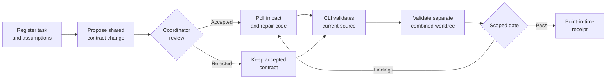

<div align="center">

# DecisionGuard

### Keep coding agents aligned across Git worktrees.

Declare shared contracts, review changes, and require fresh evidence from the code you intend to integrate.


[Quickstart](#quickstart) · [Connect an agent](#2-connect-an-agent-over-mcp) · [How it works](#3-run-the-review-and-validation-loop) · [CLI reference](#cli-workflow) · [Limits](#what-the-gate-does-and-does-not-prove)

</div>

---

Two branches can merge cleanly and still disagree about a shared behavior. In DecisionGuard's
checkout demo, one agent changes a public amount from decimal major units to integer paise
while another still expects the old unit. The merge can succeed and the amount can be wrong
by **100x**. DecisionGuard makes that declared disagreement visible before integration.

> [!NOTE]
> **Status: local alpha (`0.1.0`).** The CLI and MCP stdio server are implemented and locally
> tested. This is a trusted, same-user developer tool. It has no hosted service, mandatory
> model, or API key. Production reliability and real-user benefit have not been established.

## At a glance

| | DecisionGuard provides |
|---|---|
| **Shared decisions** | Immutable, versioned contracts and explicit coordinator review. |
| **Agent context** | Fixed-actor MCP tools for context, proposals, impact events, and gate inspection. |
| **Fresh evidence** | Locally configured test runners tied to task, source, configuration, and decision versions. |
| **Combined check** | A scoped gate against a separate worktree containing the source you plan to merge. |

It complements schemas, code generation, contract tests, and integration tests. It checks
**declared** expectations and configured validation; it does not infer arbitrary semantics.

## Quickstart

You need Git, [Python 3.11+](https://www.python.org/downloads/), and
[uv](https://docs.astral.sh/uv/). From a clone of this repository:

```powershell
uv sync --locked --group dev
uv run decisionguard demo
```

The demo creates disposable, linked Git worktrees under `artifacts/`. It shows a pending
impact, a blocked gate, a repaired implementation, and a fresh passing combined check.
Agents are simulated; the validation and worktree operations are real local operations.
No model is called. See the [demo walkthrough](examples/checkout/README.md).

To try the deterministic case benchmark separately:

```powershell
uv run decisionguard benchmark
```

This is a planted diagnostic fixture, not a live-agent effectiveness score. If Windows blocks
the default uv cache, set `UV_CACHE_DIR` to a writable directory outside captured source.

## Use it on your project

### 1. Initialize shared state

Create a runner JSON file **outside your project's captured source**. Point it at the Python
environment and tests for *your* repository (the Windows path below is an example):

```json
{
  "argv": ["D:/YourRepository/.venv/Scripts/python.exe", "-m", "pytest", "-q"],
  "cwd": ".",
  "timeout": 120,
  "output_limit": 16000
}
```

From the DecisionGuard checkout, initialize and diagnose the target repository:

```powershell
uv run decisionguard --root D:/YourRepository init coordinator D:/scratch/runner.json
uv run decisionguard --root D:/YourRepository doctor
```

The coordinator name is the local actor authorized to review proposals. The runner is a
reviewed local command; MCP requests cannot replace it with a supplied command. State and
configuration live at `<git-common-dir>/decisionguard/`, so linked worktrees share them.
Independent clones do not. Keep the SQLite state on a local filesystem with WAL support and
out of version control.

For a preview-first setup that registers several tasks at once, see the
[alpha onboarding guide](docs/ALPHA_WORKFLOW.md). It previews by default and applies only
with `--apply`.

### 2. Connect an agent over MCP

Configure one fixed actor per coding session. Example Codex configuration on Windows:

```toml
[mcp_servers.decisionguard]
command = 'D:\DecisionGuard\.venv\Scripts\python.exe'
args = ['-m', 'decisionguard.adapters.mcp', '--root', 'D:\YourRepository-frontend', '--actor', 'frontend']
```

Replace the absolute paths and actor. On Linux/macOS, use the installed environment's
`bin/python`. The installed `decisionguard-mcp --root <worktree> --actor <name>` entry point
is equivalent. Give each session its own configuration and linked worktree root. Reload the
client and confirm its DecisionGuard tools appear.

You can generate a Codex configuration preview with:

```powershell
uv run decisionguard --root D:/YourRepository setup codex frontend
```

The preview does not edit global settings. MCP-created tasks require coordinator scope
approval through the **local CLI** before they can propose or validate. The optional
[workflow skill](skills/decisionguard-workflow/SKILL.md) describes polling checkpoints; it
does not make an agent comply automatically. Full setup details are in
[MCP_SETUP.md](docs/MCP_SETUP.md).

### 3. Run the review and validation loop



Registration records the worktree, allowed changed paths, and accepted contract dependencies.
An agent declares what its implementation expects. A proposal never silently changes the
accepted contract; a configured coordinator must accept or reject it. Acceptance publishes an
immutable version, emits durable impact events, and invalidates affected evidence atomically.

Agents poll events before editing a shared boundary, after substantial work, and before
completion. **Acknowledging an event is not validation.** After an accepted change, inspect
context, repair the code, refresh dependencies, and declare changed expectations. The CLI
then runs the reviewed test command against current source. A newer failed or interrupted
validation blocks an older success.

For multiple tasks, prepare a **distinct linked integration worktree** containing the actual
combined source. Register and validate its integration task, then check the multi-task gate.
DecisionGuard does not merge branches. A receipt is valid for the checked point in time; it
does not make a later Git merge atomic.

## CLI workflow

Structured mutations take a JSON request file. Store request files outside captured source
or in the shared state directory. Every mutation needs an `actor` and `idempotency_key`:
an identical retry returns its recorded result, while a changed payload using the same key
fails. Run these examples from the DecisionGuard checkout with
`uv run decisionguard --root D:/YourRepository <command> <request.json>`.

<details>
<summary><strong>Example requests: task, proposal, review, assumption, validation</strong></summary>

Register a task before proposing its first contract (`task task.json`):

```json
{"actor":"backend","task_id":"backend","idempotency_key":"register-backend-1","worktree":"D:/YourRepository","paths":["src/checkout.py","tests/test_checkout.py"],"contracts":[]}
```

Propose a versioned contract (`propose propose.json`):

```json
{"actor":"backend","task_id":"backend","idempotency_key":"public-contract-1","contract":{"boundary":"checkout.public.request","key":"amount.unit"},"value":{"kind":"money_unit","value":"INR.major.decimal-string"},"expected_version":0,"scope":["src/checkout.py","tests/test_checkout.py"],"rationale":"Public clients send decimal major units"}
```

Use the returned proposal ID for explicit coordinator review (`review review.json`):

```json
{"actor":"coordinator","idempotency_key":"review-public-1","proposal_id":"REPLACE_WITH_RETURNED_ID","accept":true,"expected_version":0,"rationale":"Reviewed public boundary"}
```

Declare an implementation expectation (`assume assume.json`):

```json
{"actor":"backend","task_id":"backend","idempotency_key":"assume-public-1","contract":{"boundary":"checkout.public.request","key":"amount.unit"},"expected":{"kind":"money_unit","value":"INR.major.decimal-string"},"observed_version":1,"evidence":["src/checkout.py"]}
```

Run the locally configured test runner (`validate validate.json`):

```json
{"actor":"backend","task_id":"backend","idempotency_key":"validation-1"}
```

</details>

Poll with `events backend backend --after 0 --limit 100` and retain the returned cursor.
`ack` records delivery; `refresh` updates observed versions but does not reconcile code or
create validation evidence. Use a **new** idempotency key for a new validation attempt.
Optional `task_runners` can select a runner per task; configuration changes require fresh
validation.

After validating each implementation task and the distinct integration task:

```powershell
uv run decisionguard --root D:/YourRepository gate --task-id frontend --task-id backend --integration-task integration
```

A single-task gate checks that task's readiness only. Multiple tasks require an integration
task and worktree. Gate exit code `0` means the declared scope passed, `1` means blocked or
unknown, and `2` means an operational/input error. See [design.md](design.md) for protocol
details and [CI_EXAMPLE.md](docs/CI_EXAMPLE.md) for reviewed metadata transfer and fresh CI
evidence.

### MCP tool map

| Need | Tools |
|---|---|
| Context and declarations | `get_context`, `register_task`, `declare_assumption` |
| Review | `propose_decision`, coordinator-only `review_proposal` |
| Durable change delivery | `poll_events`, `acknowledge_event`, `refresh_dependencies` |
| Read-only inspection | `list_conflicts`, `explain_impact`, `check_gate` |
| Optional previews/history | `preview_contracts`, `list_advisories` |

The MCP server has **no validation tool**. Only the trusted local CLI runs configured
commands. The server uses the official Python MCP SDK over stdio and reserves stdout for
protocol messages.

## What the gate does and does not prove

The gate blocks on conflicts, relevant pending proposals, stale dependencies, missing or
stale runner evidence, changed files outside approved scope, and unknown declared coverage.
Evidence is bound to current source, configuration, and decision versions. Tracked and
nonignored untracked files are captured; Gitignored untracked files and explicit exclusions
are outside the default snapshot.

Coverage is declared rather than inferred from arbitrary code. A passing gate establishes
only the configured checks and declared scope. It cannot establish whole-repository
correctness, detect every hidden business assumption, force an agent to poll, or protect
against a same-user process that can alter local configuration or state. For the reproduced
threats and fixes, see the [security audit](docs/SECURITY_AUDIT.md).

## Operations and further reading

| Task | Command or guide |
|---|---|
| Inspect project health | `decisionguard --root <repo> doctor` |
| Explain current impact | `decisionguard --root <repo> impact` |
| Poll once from CLI | `decisionguard --root <repo> watch frontend frontend --once` |
| Back up shared state | `decisionguard --root <repo> backup <new-backup.db>` |
| Preview maintenance | `decisionguard --root <repo> maintain` (`--apply` changes state) |
| Explore reviewed OpenAPI imports | [Full-stack checkout example](examples/fullstack-checkout/README.md) |
| Evaluate incremental value | [Paired study](docs/PRODUCT_EVALUATION.md) and [strong baseline fixture](examples/strong-baseline/README.md) |

Existing schema 1/2 databases require all clients to stop before
`decisionguard --root <repo> migrate --sessions-stopped`. Migration backs up state and
invalidates previous validation; regenerate evidence afterward. Fresh CLI task registration
approves its supplied scope locally. MCP-created scopes need explicit coordinator CLI
`approve-task-scope` approval. See [MCP setup](docs/MCP_SETUP.md) and
[alpha operations](docs/ALPHA_WORKFLOW.md) before migrating or restoring state.

Optional Jev classification is advisory only. Install it with
`uv sync --locked --extra jev --group dev`; only an explicit `advice classify` command sends
a previewed, bounded payload using `DECISIONGUARD_JEV_API_KEY`. It never accepts a proposal
or clears a gate. See [advisory evaluation](docs/ADVISORY_EVALUATION.md). A portal and
automatic agent-to-agent delivery are not implemented.

### Verify this checkout

```powershell
uv run ruff format --check .
uv run ruff check .
uv run mypy
uv run pytest
```

The suite includes multiprocess writes, linked worktrees, source/configuration drift,
retries, combined-source checks, and real MCP client transport. See [memory.md](memory.md)
for recorded local results and limits. Configured CI is not evidence of a remote run until
it actually executes against the reviewed revision.

DecisionGuard is [MIT licensed](LICENSE) (`Copyright (c) 2026 Kaushik Mukherjee`).
Dependencies retain their own licenses. For product and implementation contracts, read
[PRD.md](PRD.md), [architecture.md](architecture.md), [design.md](design.md),
[rules.md](rules.md), and [tasks.md](tasks.md).
